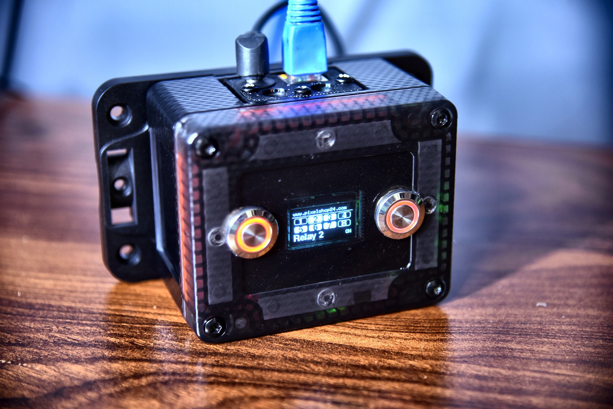
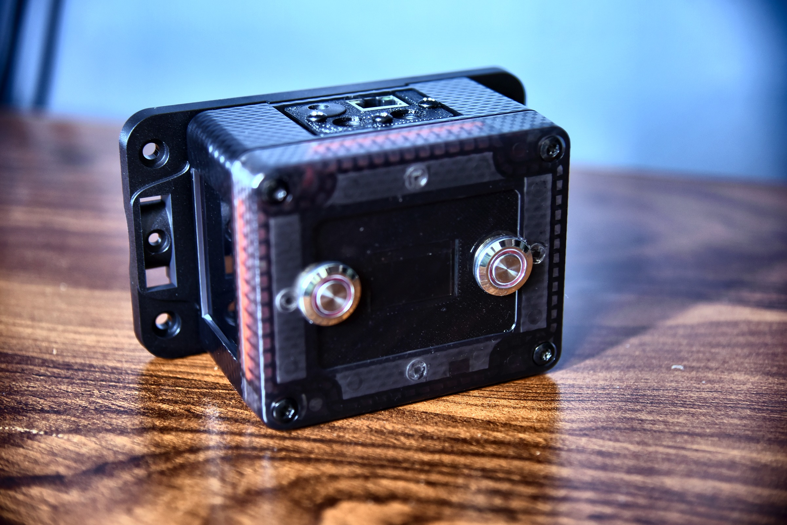
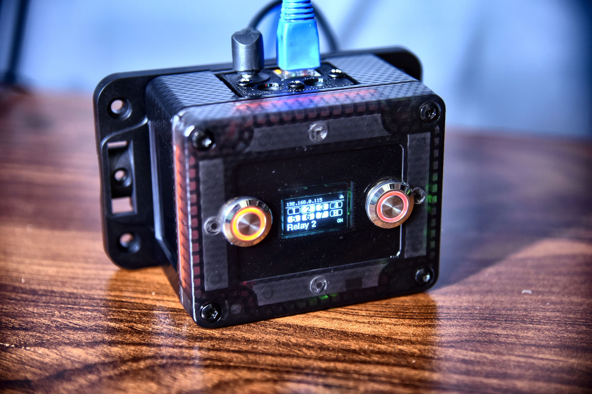
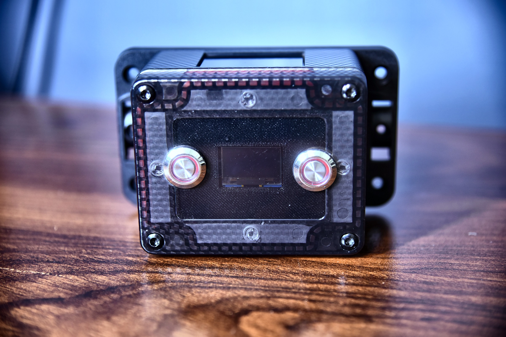
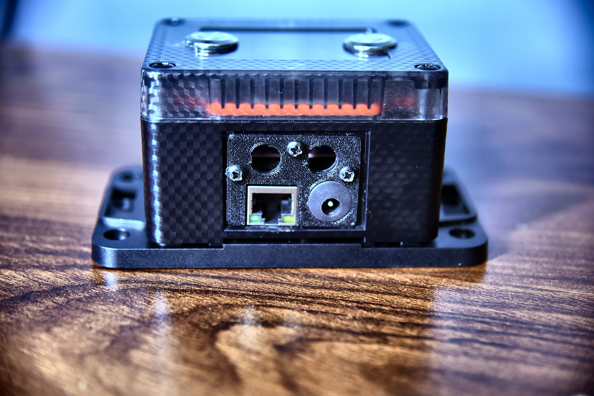

  

<h1 align="center">ByteRelay</h1>

  An 8-channel, Ethernet-controlled relay controller for buildings — a web panel, physical buttons, schedules, scenes and a secure API, built to run 24/7 and recover from faults by itself.

  
  
  
  
  
  

---

## What this repository is

This repo hosts the **official firmware releases** (signed, ready-to-flash `.bin` files) and the **user documentation** for ByteRelay — a physical product designed and made by **AliXByte**.

ByteRelay itself — the assembled, cased, tested hardware — is sold through **[pixelshop24.com](https://www.pixelshop24.com)**.

> **Source code is not published here.** This repository exists so owners of a ByteRelay unit can download official firmware updates and documentation, and so other systems (n8n, home automation, your own software) can read the API reference and integrate with a unit they own. It is not a build-it-yourself repository.

## What ByteRelay does

- Switches up to **8 relays** — on, off, toggle, or a timed pulse — from the web panel, two front buttons, schedules, scenes, or a secured REST API.
- **LAN only, by design.** No Wi-Fi code exists in the firmware at all — the radio is never started. Nothing to deauth, nothing to jam.
- **Protects your equipment**: minimum on/off dwell time, interlock between two relays (e.g. a motor's up/down), staggered switching to limit inrush, and a rate limit per relay.
- **Remembers state after a power cut** — each relay can come back Off, On, or "as before."
- Up to **8 scenes** and **16 weekly schedules**.
- A **secure API** (simple bearer tokens or HMAC-signed, replay-proof requests) with per-key scopes, relay restrictions, address allow-listing and rate limits — built for integration with n8n or your own controller.
- Small OLED display + two illuminated buttons for everything you need without a computer.
- Self-recovering: watchdog, heap guard, Ethernet link supervision, display supervision, and automatic rollback if a firmware update doesn't start cleanly.

Full behaviour, the web panel tour, the API reference and security notes are in the **[User Datasheet](docs/ByteRelay_User_Datasheet_EN.pdf)** ([فارسی](docs/ByteRelay_User_Datasheet_FA.pdf)).

## Gallery

<table>
<tr>
<td></td>
<td></td>
</tr>
<tr>
<td></td>
<td></td>
</tr>
</table>

## Specifications

| Item | Value |
|---|---|
| Relays | Up to 8 (unit-dependent; unused channels show a lock icon) |
| Network | Ethernet 10/100 only — no Wi-Fi, DHCP or fixed address, `byterelay.local` |
| Scenes / Schedules | 8 / 16 |
| API keys | 8, each independently scoped |
| Pulse length | 0.2 s – 1 hour |
| Automatic switch-off | 1 s – 24 hours |
| Panel / display language | English, فارسی |
| Default login | `admin` / `admin` (forced change at first sign-in) |
| Firmware update | From the panel, with automatic rollback if the new version fails to start |

## Getting a unit

ByteRelay is sold assembled, cased and tested — order it at **[pixelshop24.com](https://www.pixelshop24.com)**.

## Getting the firmware

Firmware `.bin` files are not published in this repository. If you need a copy — a replacement unit, a
recovery flash, or you're integrating against a unit you already own — message **[@AliXByte](https://t.me/AliXByte)**
on Telegram. Replies usually land within 24 hours.

Generic flashing instructions (for once you have the file) are in [`firmware/README.md`](firmware/README.md).

## Firmware updates

Normal firmware updates happen **from the web panel** (System → Firmware update), with automatic rollback
to the previous version if the new one doesn't start cleanly — this is how almost every owner updates,
and it needs nothing from this repository.

## Using the API

ByteRelay exposes a REST API (off by default, enabled per-unit in the panel) for integrating with n8n, home-automation systems or your own software. The request/response reference, authentication modes and a worked example are in the [User Datasheet](docs/ByteRelay_User_Datasheet_EN.pdf), §6.

## Security notes

- The panel and the API speak plain HTTP on your local network. Don't expose the device to the internet directly — put a reverse proxy with HTTPS in front of it, or use a VPN.
- Keep the API disabled if you don't use it; when you do, scope each key to only the relays and rights it needs.
- Safety-critical loads (gates, doors, heaters) should always have their own hardware safety devices — a network controller must never be the sole protection.

Full guidance: [User Datasheet](docs/ByteRelay_User_Datasheet_EN.pdf), §8.

## License

This repository (firmware binaries, documentation and images) is © AliXByte. See [LICENSE](LICENSE) for the terms under which the firmware may be used and redistributed.

---

Designed &amp; developed by <b>AliXByte</b> · <a href="https://www.pixelshop24.com">pixelshop24.com</a>

